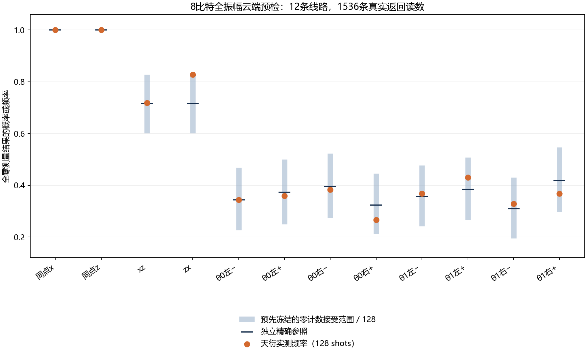

# 8比特云端预检实测（2026年11月14日）

天衍全振幅后端本批12条8比特线路全部完成，取回1536条逐次读数，结构、位序、概率直方图、任务对应及返回线路哈希均通过核验。12条零计数均落入提交前冻结的联合统计检查范围。本轮未启动股票搜索，没有KTA提升或股票分类准确率结果。

结果读数包含任务ID；返回线路接口采用逐个任务ID读取，12份返回线路本身均未包含任务ID字段，因此线路对应依据单ID请求及哈希一致性，不宣称核对了不存在的返回字段。

## 执行范围与时间

一次批量提交，每条128 shots。每条线路包含254个非测量指令、8个测量，逻辑ASAP深度70；40个解析构造输入分5个编码块，全部8比特参与。无影负责提交、读取与核验；量子线路在天衍云端执行。本批没有发送实验室股票数据。

北京时间2026-11-14T22:59:12.204368+08:00预约，2026-11-14T22:59:31.802272+08:00完成核验。预约至核验约19.598秒；包含提交前资源检查的客户端流程约19.722秒，共3次结果查询。**这些是客户端流程耗时，包含查询间隔，不是服务端纯计算时间。**接口未提供可独立确认的服务端耗时或峰值内存。

新窗口外层截止为2026-11-17T22:59:12.204368+08:00，但本轮单批授权已完成并封闭，不会利用剩余时间追加任务。未触发300秒停止条件。旧8条／1024请求shots保持；本实验账本累计20条／2560请求shots，全部已核验。此累计不包含11月8日等更早的其他容量探测。

## 实测与冻结参照

|序号|线路|零计数|精确参照p(0)|冻结零计数范围|核验|
|---:|---|---:|---:|---|---|
|1|same-x|128/128|1.000000|[128, 128]|通过|
|2|same-z|128/128|1.000000|[128, 128]|通过|
|3|pair-xz|92/128|0.716175|[77, 106]|通过|
|4|pair-zx|106/128|0.716175|[77, 106]|通过|
|5|param0-left-shift-1|44/128|0.344077|[29, 60]|通过|
|6|param0-left-shift+1|46/128|0.372635|[32, 64]|通过|
|7|param0-right-shift-1|49/128|0.395994|[35, 67]|通过|
|8|param0-right-shift+1|34/128|0.322852|[27, 57]|通过|
|9|param1-left-shift-1|47/128|0.356326|[31, 61]|通过|
|10|param1-left-shift+1|55/128|0.383867|[34, 65]|通过|
|11|param1-right-shift-1|42/128|0.308863|[25, 55]|通过|
|12|param1-right-shift+1|47/128|0.419088|[38, 70]|通过|

图中的浅色线段是参照概率下预先确定的接受范围，不是由本次结果拟合出的置信区间。联合显著性水平0.05，通过12项Bonferroni分配；不以此认证读数独立同分布或完整概率分布正确。交换输入线路zx的106次命中恰在接受上界；保留该观测，不追加采样修饰结果。

## 梯度精度的限制

考虑同一参数在重叠线路两端的依赖，经验导数按左端正负移位差减去右端正负移位差，再除以2组合。本批参数0估计为0.06640625，精确参照为0.05084990；参数1估计为0.01171875，精确参照为-0.04134161，符号相反。

在独立二项抽样假设下，冻结参照对应两者标准误约0.0423和0.0425。由此不能把单条概率检查通过解释为梯度精度充分或微调有效，也不能从本次成功推断完整搜索的吞吐稳定。当前证据支持本组编码、纠缠、重叠核和参数移位线路能够提交、测量并返回可检查读数。

## 复现与状态

- [逐线路汇总CSV](preflight8_20261114.csv)与[汇总JSON](preflight8_20261114.json)。
- [结果复核Notebook](../../notebooks/qukernet_cloud_v2/07_8qubit_preflight_results.ipynb)，仅读取汇总，不自动提交任务。
- 本轮执行前原50项与新16项离线检查均通过；真实执行后独立复核保留原始响应、线路、哈希和账本。
- 后续完整先导仍须明确等待协议和预算；此次不自动继续。不因128 shots下梯度不稳定就自行增加shots或更换后端。

历史全振幅30比特成功、36比特失败且原因未知、稳定子64比特账户权限拒绝保持原记录。本次8比特成功没有重新测定云端容量上限。
