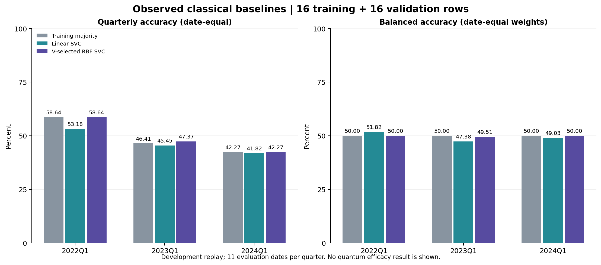

# 微调与股票预测效果验证：执行说明与已有经典证据

本页使用2026年11月14日冻结的经典证据与实验协议，说明已授权三季度云端实验应如何判断。**本页尚无完整云端微调或股票预测效果结果。**表格与图中的数值全部来自已完成的本地经典基线计算；云任务是否完成须依据后续账本与结果更新，不能从本页推断。

此前12条8比特预检全部核验通过，证明相应编码、纠缠、重叠核与参数移位线路能够返回可检查结果；这一证据不能替代微调有效、搜索有效或预测有效的检验。[预检记录](8比特预检实测_20261114.md)

**执行前实现核验（2026年11月15日更新）**：部署依赖与输出路径保护问题已在云提交前处理。无影上的完整离线检查130项全部通过，包括实际神经评分器的序列化重载、重叠线路双端梯度、完整配置终点、输出路径隔离，以及重复提交和超时停止控制。部署核验记录显示该检查阶段云提交为0、既有账户账本保持不变。这些结果支持已检查实现与执行保护按预期工作；云端微调与季度预测效果仍须等待真实实验结果，不能由测试通过替代。

## 云端执行进展：2026年11月15日02:08:43（北京时间）

主实验持续运行，当前执行2024Q1的 QuKerNet 组。首次预约为11月15日00:05:59，72小时截止为11月18日00:05:59。截至本次观察，已预约196批、3,824条概率线路、1,957,888请求shots；其中195批、3,804条线路完成核验，覆盖1,947,648请求shots，另有一批20条线路正在执行。最近核验记录处于第1条入围线路、第1种微调配置的终点验证阶段。6组主实验均尚未完成，当前没有可报告的本轮完整微调效果或季度预测差值。[本次执行状态快照](efficacy_execution_status_20261115_020944.json)观察于02:08:43，文件于02:09:44保存。

[00:10:38的历史快照](efficacy_execution_status_20261115_001102.json)和[00:06:34的历史快照](efficacy_execution_status_20261115_000719.json)继续保留。预约数、核验数与完整实验组数分别解释。本页为有时间标记的记录，不是实时运行面板；时间和预算约束不因本次更新而重置。

## 这次分别检验什么

| 问题 | 比较 | 可以支持的结论 |
|---|---|---|
| 微调是否改善季度预测 | 获选 QuKerNet 配置的更新终点，减去该配置同一线路、同一替换位置的初值 θ₀；两者分别重新拟合 SVC | 该获选配置相对自身初值的条件性变化 |
| 神经筛选是否有帮助 | QuKerNet 获选终点减同量子评价配额的随机搜索获选终点 | 该窗口与该种子下的搜索方法差异 |
| 股票预测是否有帮助 | QuKerNet 获选终点减验证集选定的 RBF SVC；同时展示简单基线 | 该开发回放和小样本条件下的预测差异 |

每种微调配置都保存初值与终点的训练、验证评价，但只有**微调终点的验证表现**用于最终选核。季度评价再比较该获选配置的终点与自身 θ₀。这个配对不估计全部配置的平均微调效应，也没有单独选择一套“最优未微调方法”。

训练 KTA 与季度准确率是不同量。分类 KTA 使用同类为 +1、异类为 −1 的目标矩阵 Y，计算 ⟨K,Y⟩F/(‖K‖F‖Y‖F)。提高这个训练代理目标不保证提升验证或季度准确率。当前分类定义没有改成回归中心化对齐；2024Q1 的16个训练标签中有14跌、2涨，应同时检查核接近常数和分类偏置。

## 冻结实验设置与资源账本

执行顺序为2024Q1、2023Q1、2022Q1；每季度先 QuKerNet、后随机搜索，共6组。统一种子20261110，8比特、40项训练内选择的量价特征、重上传深度1—5。各组16个训练样本、16个验证样本，下游 SVC 固定 C=1。所有云端核与参数移位线路均为512 shots。

QuKerNet用16条完整训练核标签（12条训练评分器、4条留出诊断），经典预测512条新候选，再实测2条入围线路。随机搜索独立测量18条训练核，按训练 KTA 选2条。两者各对2条入围线路执行2种配置；每配置固定2个替换参数，3步、batch 8、步长0.2。神经评分器为128隐藏单元、ReLU、标签乘10、Smooth L1、Adam 0.01、30轮、batch 32。

两种方法不复用彼此的测量结果；相同量子评价配额不等于相同实际耗时。512条经典预测候选也不等于512次量子核计算。

| 两种方法合计 | 概率线路上限 | 请求 shots 上限 | 提交批次上限 |
|---|---:|---:|---:|
| 2022Q1 | 31,488 | 16,121,856 | 1,612 |
| 2023Q1 | 30,784 | 15,761,408 | 1,580 |
| 2024Q1 | 31,488 | 16,121,856 | 1,612 |
| 合计 | **93,760** | **48,005,120** | **4,804** |

预算覆盖双端正负参数移位、所有配置初值与终点、获选配置的季度配对评价。无效配置不补抽，失败和状态不明的尝试也记账；这些数字是授权上限，不是已经执行的次数。

天衍全振幅 `tianyan_sw` 执行量子线路；无影执行数据处理、神经评分器、SVC、调度及独立校验。本轮主实验没有本地量子模拟替代。首次主实验预约启动72小时窗口；每批至多20条，从预约到完成核验共用300秒。任一批提交不明、明确失败、结果异常或到时未核验，停止全部新增提交与自动轮询。客户端停止不代表后台取消，迟到结果不自动恢复实验。每配置的3步优化另限1800秒；初值、终点与季度评价分别计费。无影最多8线程、32 GiB进程树内存、10 GiB私有缓存。

## 已实测的经典基线

以下指标来自冻结数据的真实计算，运行位置为本地经典环境，云提交与请求 shots 均为0。训练、验证及特征与计划中的量子组一致。RBF 在特征角度/π上取 γ=0.1、1、10，仅以验证准确率选 γ，并列选较小值。训练多数类平票预测0。固定上涨、固定下跌是分别预设的基线，不能看过季度结果后再选择其中较好者作为已部署策略。

| 季度 | 训练多数类 | 固定预测下跌 | 固定预测上涨 | 线性 SVC | RBF SVC | RBF 的 γ |
|---|---:|---:|---:|---:|---:|---:|
| 2022Q1 | 58.64% | 58.64% | 41.36% | 53.18% | 58.64% | 1 |
| 2023Q1 | 46.41% | 46.41% | 53.59% | 45.45% | 47.37% | 0.1 |
| 2024Q1 | 42.27% | 42.27% | 57.73% | 41.82% | 42.27% | 0.1 |

图中使用按日期等权的季度准确率。对 D 个评价日期，日期 d 含 n_d 条股票记录，每条记录权重为1/(D n_d)；季度准确率是各日准确率的平均。平衡准确率由同样日期权重的混淆质量计算两类召回率的平均。每季度只有11个评价日期，220/209/220条股票记录不等于同样数量的独立市场样本。

RBF 对多数类的三季度等权准确率差为 **+0.32个百分点**；季度内相邻日期移动块、主块长2、10,000次配对重采样的探索性95%区间为 **[−1.59，+2.87]个百分点**。块长1、3作为敏感性分析。区间跨零，当前经典结果不能支持 RBF 相对多数类的可靠优势。2022Q1与2024Q1的 RBF 硬分类始终为跌，与训练多数类相同；AUC另用连续决策分数计算，因此可能不同于0.5。

重采样在季度内抽取非循环的相邻日期块，再将季度等权汇总。它不覆盖重新搜索种子、重新云采样或模型选择本身的不确定性，也不是多重比较校正后的确证区间。公开汇总足以重画图和核对三季度均值，不能重建逐日期配对重采样；原始配对记录留在私有证据中。

## 如何接收未来结果

云端完成后，每个季度必须有可对应的任务账本、完整配置终点、验证选核记录、同配置 θ₀/终点季度预测和随机搜索对照，才计算相应配对差值。缺失季度不填零；部分完成必须同时列明覆盖范围、失败和未运行项。

分别报告训练 KTA、验证准确率、季度按日期等权准确率、平衡准确率、两类召回率、混淆矩阵、AUC、核谱修正幅度与全流程成本。KTA上升而季度不改善，仅支持优化了训练代理目标；季度结果方向相反、区间跨零、退化多或运行不完整时，应写“证据不足”。

2022—2024属于开发期历史回放，2025继续封存。当前D0原始价标签为“收盘后预测次日开盘至第6个交易日开盘收益是否大于0”；公司行动、成交和成本口径尚不足以支持正式策略净收益。任何上述结果都不直接证明未来盈利或量子优势。

## 从实验记录到课程和研究

下表区分当前可用证据与后续研究条件。后续建议不改变正在运行的冻结实验，也不代表已授权新增云任务。

| 内容与课程用途 | 当前证据或待完成结果 | 科研判断与后续条件 |
|---|---|---|
| 编码、重叠核与云端复现 | 离线检查、8比特预检已完成；三季度完整链条运行中 | 支持已检查实现与接口能够运行；完整链条需以各阶段记录齐全为准 |
| 训练目标与评价指标 | 保存各配置初值、终点KTA及核接近常数程度，完整结果待收集 | KTA变化与季度预测变化分别判断，当前少量配置不足以建立普遍关联 |
| 微调的配对比较 | 待获选配置自身θ₀与终点季度评价完成 | 估计该获选配置的条件性变化；总体微调作用需独立配置或全配置配对和多次重复 |
| 神经筛选与随机搜索 | 两种方法配额相同，各自独立云测量，完整对照待完成 | 比较本窗口、种子和配额下的差异；更稳健结论需多种子及预算曲线 |
| 股票预测与经典基线 | 经典基线已完成，量子季度预测待完成 | 小样本开发回放中的相对预测效果；扩大样本和市场阶段后再冻结方案使用2025 |
| 有限测量与选择可靠性 | 本轮统一512 shots，记录测量、梯度与调度成本 | 单档单种子无法估计选核不稳定概率；后续固定候选池，增加shots档和独立重复，考察损失差、选择频率、简单遗憾及超阈值失选 |
| 任务驱动的测量分配 | 本轮不执行自适应分配 | 后续比较均匀、方差驱动与损失差驱动分配；读数共享另核物理相容性，并设置同预算对照 |

完整和未完成项都纳入课程的复现审计。量子模型未改善时，课程仍可展示评价纪律、负面结果和资源成本；科研报告按实际配对结果决定结论。

## 教学练习与公开文件

1. 使用公开汇总重算三季度等权准确率差，说明为什么与把全部股票行直接合并不同。
2. 对照准确率、平衡准确率、召回率和 AUC，解释“多数类也能取得较高准确率”。
3. 画出训练 KTA → 验证选核 → 季度评价的信息流，标明哪个阶段可以选择配置。
4. 从预算表核算 shots，并解释批次数为什么不能简单由总线路数除以20得出。
5. 列出还缺哪些证据，才能回答微调、搜索和预测三个问题；没有量子结果时不填预测曲线。

- [可执行教学 Notebook 08](../../notebooks/qukernet_cloud_v2/08_微调与季度预测效果核验.ipynb)：只读取公开汇总，不登录或提交云任务。
- [经典实测汇总 CSV](efficacy_classical_aggregates_20261114.csv)
- [经典证据、区间与授权预算 JSON](efficacy_classical_snapshot_20261114.json)
- [已实现的搜索与同配置初值对照](../../experiments/qukernet_finance/cloud_v2/search.py)
- [指标与配对重采样实现](../../experiments/qukernet_finance/cloud_v2/efficacy_analysis.py)

本页与 Notebook 未包含账户凭据、实验室原始数据、逐样本预测、线路角度或核矩阵。源码与运行证据分开管理，既有实验记录保持原版本。
