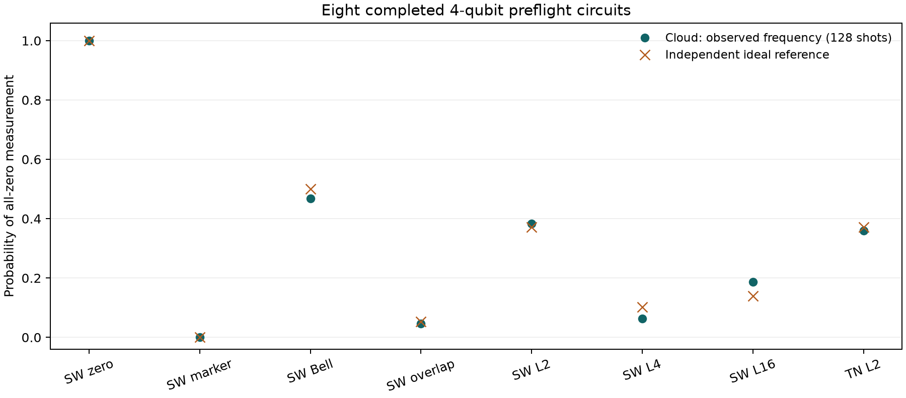

# 天衍旧任务完成与结果核验（2026年11月14日）

2026年11月10日提交的7条全振幅任务和1条张量网络任务已完成。此次从官方SDK接口取回共1024条原始读数；逐条检查任务对应关系、128条二进制读数、Q1至Q4列标签、概率表与直方图、返回QCIS的哈希，8条全部通过。此次没有新增提交。

这8条都是4比特解析预检。零态全部为0000，指定Q1翻转全部为1000；Bell线路只出现0000（60次）和1100（68次）。表内“精确参照”来自本地独立理想模拟；云端“概率”与128条读数频率一致，不能当作独立精确概率输出。

|线路|返回读数|全零次数|经验概率|精确参照|
|---|---:|---:|---:|---:|
|SW 零态|128|128|1.000000|1.000000|
|SW 指定位翻转|128|0|0.000000|0.000000|
|SW Bell纠缠|128|60|0.468750|0.500000|
|SW 非平凡重叠核|128|6|0.046875|0.053437|
|SW 连续旋转2层|128|49|0.382812|0.371781|
|SW 连续旋转4层|128|8|0.062500|0.101725|
|SW 连续旋转16层|128|24|0.187500|0.140100|
|TN 连续旋转2层|128|46|0.359375|0.371781|

张量网络的全零计数46位于提交前冻结的[34,62]区间内（理想p0=0.371780868926975，128次测量）。这项检验只针对一个标量；没有证明完整分布准确、各次采样独立或张量网络没有截断误差。其余随机线路没有在本次追加预注册检验，图中与参照的比较用于描述结果。

## 时间与此前超时

张量网络任务网页记录创建于北京时间11月10日09:21:52，开始于11月11日10:14:58.170，结束于10:14:58.792，运行时间0.622秒。创建至开始约24小时53分，等待原因未披露。不能把此前客户端五分钟观察超时写成后台失败，也不能把约25小时全算作仿真计算时间。其他任务的服务端时长本次未核实。

最初本地读取脚本将API的嵌套data.experimentResultModelList当成列表，出现包裹层解析错误。已保留原响应，随后从缓存按官方结构核验并取回线路，没有重新提交量子任务。此错误属于读取工具，不属于天衍任务失败。

## 能支持的结论与续接

本次验证了指定4比特线路的门操作、纠缠、重叠核读数和结果回收流程。张量网络本次最大完成规模仍为4比特、2层；其余预备的8/16/24/30比特任务未提交。历史全振幅30比特成功、旧36比特失败且原因未知、稳定子64比特权限拒绝的事实不变。

完整股票云端搜索尚未启动。本次取回和核验在本地Windows进行，无需开启无影；无影后续仍可用于数据、神经评分器、经典拟合和独立校验。

原72小时新增提交窗口已于北京时间2026年11月13日01:55:40结束。剩余名义额度不自动构成新的执行窗口。后续需制定新的时限与配额，再完成未运行预检并进入8比特先导。远程账本本次未同步，续跑前须将这些旧任务的已验证结果与远程账本对账。

## 历史与来源

- [本次公开汇总数据](preflight_completed_20261114.json)
- [最新累计状态](evidence_summary.json)
- [11月10日首次四任务状态快照](evidence_summary_snapshot_20261110.json)

原始逐次读数、任务编号、返回线路和详细核验日志保存在仓库外的私有证据目录。旧CSV、旧DOCX和历史容量图保留其观察时点，不覆盖为仿佛首次观察即成功。
